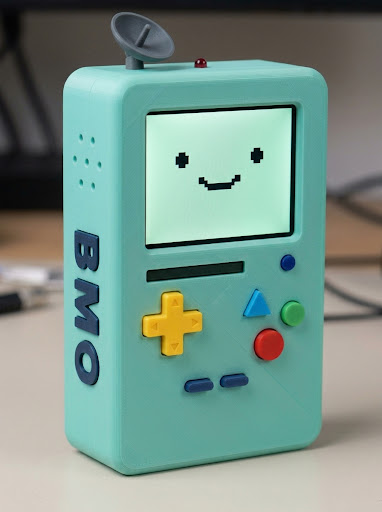
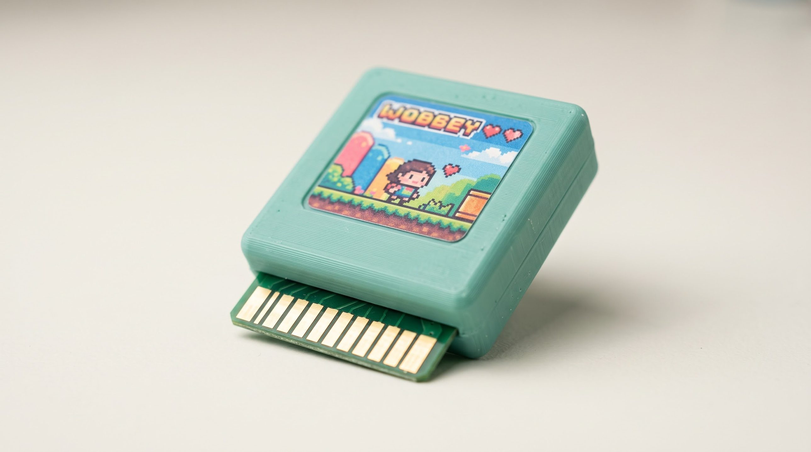
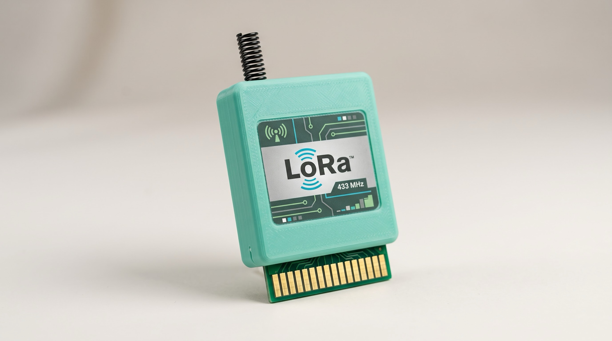

# dark-bmo

<p align="center">
  
  <br>
  <sub>Conceito visual do BMO v1.</sub>
</p>

> Multitool portátil DIY de estudo de segurança da informação, estilo Flipper Zero, caseiro.
> Baseado em ESP32-S3, com cara de BMO (Hora de Aventura). Jogos retrô + RF / NFC / IR.


---

## Sobre

O **dark-bmo** (ou só BMO) é um aparelho de mão feito do zero para estudar segurança da
informação na prática: rádio sub-GHz, NFC, infravermelho, WiFi e Bluetooth. Nasceu do
reaproveitamento de um mini teclado Rii i8 achado em casa e foi crescendo até virar um
projeto completo de hardware + firmware.

O nome e o visual são **inspirados** no personagem BMO de Hora de Aventura (ver
[Aviso legal](#aviso-legal)): corpo teal, carinha fofa numa telinha, formato de
computador-brinquedo.

É um projeto de aprendizado. O objetivo é tanto a ferramenta quanto o processo de montar,
soldar, entender barramentos e escrever firmware.

> ⚠️ **Uso responsável.** As funções de RF, NFC e IR servem para estudar protocolos e
> testar no seu próprio equipamento, em laboratório ou em CTFs. Veja [Segurança e ética](#segurança-e-ética).

---

## Índice

- [Status](#status)
- [Pessoas do projeto](#pessoas-do-projeto)
- [Versões do projeto](#versões-do-projeto)
- [Recursos](#recursos)
- [Lista de componentes (BOM)](#lista-de-componentes-bom)
- [Arquitetura](#arquitetura)
- [Pinagem](#pinagem-esp32-s3-n16r8)
- [Alimentação](#alimentação)
- [Configurações críticas](#configurações-críticas)
- [Firmware](#firmware)
- [Rosto do BMO (tela principal)](#rosto-do-bmo-tela-principal)
- [Carcaça 3D](#carcaça-3d)
- [Montagem passo a passo](#montagem-passo-a-passo)
- [Roadmap](#roadmap)
- [Decisões de projeto (e alternativas rejeitadas)](#decisões-de-projeto)
- [Segurança e ética](#segurança-e-ética)
- [Aviso legal](#aviso-legal)
- [Licença](#licença)

---

## Status

**Planejado, parcialmente comprado, ainda não montado.** Fase atual: aguardar peças,
projetar a PCB (EasyEDA → JLCPCB) e começar o firmware.

---

## Pessoas do projeto

| Pessoa | Papel |
|---|---|
| **Resende** (Gabriel) | Lead do projeto: arquitetura, firmware, compras, documentação |
| **Tiago Batista** | Consultor de hardware: ensina EasyEDA e orienta o projeto da PCB para fabricar na JLCPCB (carga/BMS/card edge integrados). Também faz PCB caseira no laser, mas a decisão foi fábrica |
| **Tiago Efraim** | Impressão 3D da carcaça e montagem; monta um BMO em par (candidato ao cartucho LoRa p/ comunicação entre os dois) |

São dois Tiagos distintos: **Batista** cuida da PCB; **Efraim** imprime e monta junto.

## Versões do projeto

O projeto foi dividido em dois, cada um com o hardware certo para o seu propósito:

### BMO v1 (este repositório) — ESP32-S3
Jogos retrô + ataques simples de RF / NFC / IR. **Sem teclado QWERTY.** Entrada por
**botões tácteis + D-pad** (estilo controle de videogame), o que aproxima o visual do
personagem (tela grande em cima, botões coloridos embaixo) e simplifica muito a montagem.

### Projeto 2 (futuro) — Raspberry Pi + teclado Rii
Kali Linux de verdade para pentest sério. O teclado QWERTY do Rii i8 vai para cá, onde
digitar comando faz sentido. Fora do escopo deste repositório por enquanto.

---

## Recursos

| Recurso | Hardware | Firmware base |
|---|---|---|
| Sub-GHz 433 MHz | CC1101 + antena SMA | Bruce |
| NFC 13,56 MHz | PN532 (I²C) | Bruce |
| Infravermelho (TX + RX) | par KY-022 / KY-005 | Bruce |
| WiFi + Bluetooth | nativo do ESP32-S3 | Bruce |
| Jogos retrô (NES, GB, GBC, SMS, GG, PCE) | ESP32-S3 + tela + SD | Retro-Go |
| Áudio (som + mic) | MAX98357A + speaker + INMP441 | — |
| Rosto animado do BMO | tela principal ILI9341 | custom |
| Scripts / testes | — | MicroPython |

---

## Lista de componentes (BOM)

> Preços e links do AliExpress variam e expiram; use os **termos de busca** abaixo. No NFC,
> IR e áudio, confira sempre o chip (não o título genérico do anúncio).

| Item | Qtd | Termo de busca | Observação |
|---|---:|---|---|
| ESP32-S3 DevKitC-1 N16R8 | 1 | `ESP32-S3 DevKitC-1 N16R8` | 16MB flash, 8MB PSRAM, 2x USB-C, pré-soldado |
| TFT 3,2" ILI9341 320×240 SPI | 1 | `3.2 ILI9341 320x240 SPI no touch` | sem touch (MSP3217). Tela ÚNICA: rosto do BMO + menu + status |
| CC1101 433 MHz + antena SMA | 1 | `CC1101 433MHz module SMA antenna` | sub-GHz |
| PN532 V3 NFC | 1 | `PN532 NFC module V3` | DIP switch em I²C (0x24) |
| Par IR KY-022 + KY-005 | 1 | `KY-022 KY-005` | RX + TX |
| MAX98357A (amp I²S) | 1 | `MAX98357A I2S amplifier` | alimentar em 5V |
| Alto-falante 8 Ω 2 W mini | 1 | `speaker 8 ohm 2W mini` | ~28 mm |
| Mic INMP441 (I²S) | 1 | `INMP441 I2S microphone` | captação de voz |
| Módulo MicroSD SPI (mini 3,3V) | 1 | `Micro SD card module SPI` | variante mini |
| Cartão microSD 32 GB | 1 | marca (SanDisk/Samsung/ADATA) | formatar FAT32 |
| Bateria LiPo 3,7V 1S ~2000 mAh | 1 | `LiPo 3.7V 2000mAh 1S protection` | comprar por último, ~6 mm de espessura |
| Botões tácteis 6×6 | vários | `tactile button 6x6 kit` | D-pad + ação (entrada do v1) |
| Chave SPST slide mini | 1 | `SPST slide switch mini` | liga/desliga |
| Resistores 4,7k / 100k / 1k | kit | `resistor kit 4.7k 100k 1k` | pull-up I²C, divisor de bateria |
| Capacitores 100nF (104) | ~5 | `100nF ceramic capacitor 104` | desacoplamento |
| Jumpers Dupont (M-M e M-F) | kit | `Dupont jumper wire kit` | protoboard |
| Fio fino 30 AWG | 1 | `30 AWG silicone wire` | fiação fina |
| Soquete card edge 2,54 mm 20P | 1 (lote 5) | `Edge Card Connector Slot 2.54mm 2x10 20P` | série DK920A-20M; recebe o cartucho. Soldado na PCB principal. Ver Cartuchos |

**Carga + BMS + boost agora são componentes SMD na própria PCB** (projetados no EasyEDA, fabricados pela JLCPCB), não módulos avulsos TP4056/MT3608. Perfboard saiu: vai direto para a PCB projetada. Ver seção Fabricação.

**Removido do v1**: teclado Rii i8, 2× MCP23017 e soquetes DIP (foram para o Projeto 2); **OLED 1,3" secundário** (sem o teclado, uma tela só já faz rosto + menu + status).

---

## Arquitetura

```
                        ┌───────────────────┐
                        │   ESP32-S3 N16R8   │
                        │  (WiFi + BT nativo)│
                        └─────────┬─────────┘
           ┌──────────────┬───────┼────────┬──────────────┐
          SPI            I²C      I2S      GPIO          USB
      ┌────┴────┐     ┌───┴───┐  ┌─┴──┐  ┌──┴───┐      (grava/
   Display     CC1101 PN532       MAX  INMP  botões      BadUSB)
   ILI9341     MicroSD 0x24       98357 441  + D-pad
   (3,2")                          A(5V)(mic)  IR TX/RX
```

- **SPI** (SCK/MOSI/MISO compartilhados, cada um com seu CS): Display, CC1101, MicroSD.
- **I²C** (SDA/SCL): PN532 (0x24). (Tela única; sem OLED secundário.)
- **I²S**: MAX98357A (saída) + INMP441 (entrada), mesmo barramento.
- **GPIO direto**: IR RX/TX, botões/D-pad, leitura de bateria.

---

## Pinagem (ESP32-S3 N16R8)

Proposta de referência — conferir contra a serigrafia da placa; o Bruce permite setar pino a pino.

| Função | GPIO | Nota |
|---|---:|---|
| I²C SDA | 8 | pull-up 4,7k |
| I²C SCL | 9 | pull-up 4,7k |
| SPI SCK | 12 | compartilhado |
| SPI MOSI | 11 | compartilhado |
| SPI MISO | 13 | compartilhado |
| CS Display | 10 | |
| CS CC1101 | 14 | |
| CS MicroSD | 21 | |
| Display DC | 17 | |
| Display RES | 18 | |
| Display BLK | 16 | backlight (3,3V fixo ou PWM) |
| CC1101 GDO0 | 15 | interrupção RF |
| IR RX (KY-022) | 4 | |
| IR TX (KY-005) | 5 | |
| I²S BCLK | 40 | áudio |
| I²S LRC | 41 | áudio |
| I²S DOUT (speaker) | 42 | amp em 5V |
| I²S SD IN (mic) | 6 | mic em 3,3V, L/R no GND |
| VBAT sense | 1 | divisor 100k/100k, ×2 no firmware |
| Botão BOOT/power | 0 | strapping |
| Botões / D-pad (gaming) | 38, 39, 47, 48, … | GPIO livres (o teclado saiu, sobram muitos) |

**Não usar:** GPIO 26–37 (flash/PSRAM octal), 19/20 (USB nativo), 43/44 (UART0).
Cuidado com strapping: 3, 45, 46.

---

## Alimentação

Todo o caminho de energia (carga da LiPo por USB-C, proteção/BMS de 1 célula e boost 5V)
fica **desenhado na própria PCB** com componentes SMD, em vez de módulos avulsos. Fluxo lógico:

```
USB-C → circuito de carga (SMD) → LiPo 1S → BMS/proteção (SMD) → [chave] → boost 5V (SMD)
   → 5V para o ESP32 e MAX98357A → regulador onboard do ESP32 → 3,3V para os demais módulos
```

- Carga, proteção e boost são **CIs SMD na placa** (minúsculos, soldados de fábrica pela JLCPCB).
- Projeto do circuito de energia no EasyEDA, com orientação do Tiago Batista.
- Continua valendo: 5V para MAX98357A, 3,3V para o resto, nunca expor a bateria crua.
- **Limitar a corrente de carga.** A bateria LiPo 1S é pequena; 1 A (padrão dos módulos de
  carga avulsos) a estraga. Dimensionar o CI de carga para uma corrente segura (tipicamente
  ~0,5C) no EasyEDA. Essa é a parte mais crítica do projeto de energia (nota do Tiago Batista).
- **BMS obrigatório.** Proteção de 1 célula: não deixa cair abaixo de ~2,5–3,0 V nem passar de
  4,2 V, e monitora a carga. Entra como SMD na mesma PCB.

### Conector de carga USB-C dedicado

Uma **porta USB-C só para carga**, separada da porta de dados, para o usuário não confundir:

- **Só energia.** Os pinos de dados (D+/D−) ficam desligados nessa porta; ela entra no circuito
  de carga.
- **Dois resistores de 5,1 kΩ, um em cada pino CC (CC1→GND, CC2→GND), separados.** Sem eles,
  um carregador com cabo C-C entrega 0 V e o BMO não carrega. Ligar os dois CC num resistor só
  é erro clássico. Só com os resistores, a carga é a padrão de ~500 mA (mais corrente exige um
  CI de carga que negocie com o carregador).
- **A cor fica na carcaça, não no conector** (não há USB-C com isolador colorido à venda):
  moldura/anel colorido em volta da porta impresso em 3D, ícone ⚡ em relevo e o LED de carga
  ao lado. A porta de dados fica em outra posição/cor.

---

## Configurações críticas

- **PN532**: DIP switches em I²C (0x24). Plano B: HSU (serial) se instável.
- **ESP32-S3 N16R8** no Arduino IDE: `PSRAM: OPI PSRAM` e `Flash Size: 16MB`.
- **Display**: driver ILI9341 (tela única).
- **I²C**: pull-ups 4,7k em SDA/SCL. Scan deve achar `0x24` (PN532).
- **microSD**: formatar em FAT32.

---

## Firmware

Um firmware por vez (como "cartuchos de software"):

| Firmware | Uso |
|---|---|
| **Bruce** (C++) | multitool pronto (RF, NFC, IR, WiFi/BLE). Base do projeto. Suporta ILI9341 |
| **MicroPython** | escrever Python e testar cada módulo; interativo, ótimo pra aprender |
| **Retro-Go** | jogos retrô. Roda bem NES, GB, GBC, Master System, Game Gear, PC Engine. SNES/Mega Drive lento/parcial. GBA não |
| **Modo agente** (futuro) | BMO como corpo remoto de um agente de IA via WiFi/BLE (WebSocket), usando speaker/mic/tela. Só firmware, sem hardware novo |

A parte custom a escrever é a leitura dos botões/D-pad e a integração no input do Bruce/emulador.

---

## Rosto do BMO (tela principal)

O BMO tem **uma tela só** (ILI9341 3,2" colorida). Ela mostra o **rosto animado do BMO**
quando ocioso (olhos piscam, boca reage), o **menu/terminal** quando em uso, e indicadores
de **status** (bateria / sinal / atividade). Alterna conforme o estado do aparelho.

Recomendação de implementação: desenhar os rostos **por código** (ex. TFT_eSPI, com
primitivas de círculo/retângulo/linha), não por bitmap, porque são formas geométricas
simples e a animação fica leve e fluida. Mapear cada expressão a um estado do aparelho (ocioso,
escaneando, sucesso, erro, bateria baixa). Há um SVG com 30 rostos do personagem como
referência visual.

---

## Carcaça 3D

- Corpo retangular **teal**, impresso em 3D (FDM), com duas perninhas (estilo BMO em pé).
- **Layout v1** (aproxima do personagem): tela grande colorida no **topo**; abaixo, controles
  de videogame coloridos (D-pad amarelo, botões azul/verde/vermelho). **Sem teclado.**
- **Uma tela só** (ILI9341) no topo, grande, para rosto + menu + status.
- Faixa horizontal acima do D-pad: **conector de expansão** (I²C + 3V3 + GND + GPIO livre),
  com polyfuse/resistor em série na alimentação (protege o ESP32 de curto no módulo plugado).
  No desenho do personagem essa faixa é o slot/leitor do BMO, então um conector ali é fiel.
  - **Solução escolhida: card edge** (borda da PCB vira contato, estilo cartucho). Com a PCB
    indo para a JLCPCB (fábrica), a densidade deixa de ser problema e o **card edge COMPLETO**
    é viável: I²C + SPI + UART + 3V3 + 5V + GND + 2 GPIO (~13 a 15 contatos).
  - **Conector fêmea primeiro (definido):** o soquete que recebe o cartucho é escolhido antes
    do cartucho (ele dita largura, nº de contatos, pitch e espessura de placa). **Soquete
    escolhido: DK920A-20M** (card edge 2,54 mm, 2×10 = 20 contatos, furo passante/vertical,
    fenda de 1,9 mm para cartucho de 1,6 mm, contatos de ouro, 2 A/contato). Soldado na PCB
    principal. Medir a peça real antes de desenhar a pegada no EasyEDA (ver Especificação do cartucho).
  - Proteção obrigatória: polyfuse na linha de alimentação do conector e CS dedicado no SPI.
- **Traseira multifuncional (em duas zonas):**
  - Zona de cima **fixa** (parafusada, segura a eletrônica).
  - Zona de baixo é uma **tampa/porta** que abre e dá acesso a: **bateria**, **berços para
    guardar os cartuchos reserva** (estojo; o cartucho ativo pluga no card edge em cima) e o
    **slot do microSD**. O microSD fica DENTRO dessa zona, acessível só ao abrir a porta, nada
    exposto por fora (troca é rara, não vale abertura permanente juntando poeira).
  - **Fecho da tampa: 1 parafuso + lábio de encaixe no lado oposto** (sem dobradiça, sem ímã;
    dobradiça viva racha e ímã foi descartado). O lábio enfia num rebaixo e o parafuso tranca o
    outro lado.
  - **Rosca do parafuso:** reaproveitar um **standoff hexagonal de metal** (daqueles de
    placa-mãe, que Resende já tem) embutido num **furo hexagonal justo** no CAD, dando rosca
    metálica de graça. Plano B se o standoff girar na prática: **heat-set insert** M2/M3.
    Testar o encaixe hex num corpo de prova na impressão antes de fechar o design.
- Demais parafusos de fechamento da carcaça também em **heat-set/standoff na traseira** (não na frente).
- Ergonomia por chanfro/arredondamento das arestas inferiores, mantendo o corpo retangular.
- Antena SMA no topo; antena do PN532 virada para fora sem metal atrás; LED + receptor IR na
  frente; grade do speaker no canto inferior; furo do mic no topo; 2× USB-C + chave numa
  lateral. (O microSD não fica na lateral: fica dentro da porta traseira, ver acima.)
- Detalhes mecânicos precisos (recorte de botões, heat-sets, bosses) saem do **CAD**
  (Fusion / Tinkercad / FreeCAD), não de gerador de imagem.

### Fabricação: EasyEDA + JLCPCB (decidido)

Após reunião com o Tiago Batista (23/10/2026), a decisão foi **não usar perfboard nem PCB
caseira no laser**, e sim projetar a placa no **EasyEDA** e fabricar na **JLCPCB** (fábrica, China):

- **PCB única** com o ESP32-S3 e todo o circuito, incluindo **carga, BMS e boost como CIs SMD**
  soldados de fábrica (os CIs minúsculos que não dá para soldar em casa vêm prontos).
- **Mais barato do que parece:** ordem de ~R$ 100 por um lote de ~5 placas (confirmar na cotação).
- Resende só encaixa os periféricos grandes (ESP32 se não for SMD, tela, antena) quando a placa chegar.
- O **card edge** do conector de expansão sai nessa mesma PCB, com qualidade de fábrica.
- Papel do Tiago Batista: **ensinar o EasyEDA e orientar o projeto**; a fabricação é da JLCPCB.
- A JLCPCB também faz **impressão 3D / usinagem da carcaça** (plástico, alumínio, titânio) — opção
  em aberto para o corpo, concorrendo com a impressão do Tiago Efraim (ver Carcaça 3D).

Fluxo: desenhar no EasyEDA → cotar/fabricar na JLCPCB → receber → soldar periféricos → montar na carcaça.

### Cartuchos de expansão (o que o card edge permite)

O conector expõe sinais; o cartucho plugado decide a função. **Não** adiciona processamento
(o cérebro continua sendo o ESP32) nem é slot de armazenamento rápido. Com o nível completo,
os cartuchos possíveis:

- **Rádio/RF extra** (via SPI): segundo rádio em outra frequência (868, 315), LoRa, outro NFC/RFID.
- **GPS** (via UART/I²C): georreferenciar capturas.
- **Sensores e módulos** (via I²C): ambientais, telas pequenas, leitores, e os módulos prontos
  da M5Stack/Seeed.
- **Cartuchos temáticos**: cada cartucho como uma "ferramenta" ou "jogo" físico, no espírito do
  cartucho de videogame do BMO.

**Referências visuais (família de cartuchos):** dois conceitos, mesma carcaça teal e mesma
borda de contatos dourados, mudando só etiqueta e antena:

| Cartucho de jogo (etiqueta pixel art) | Cartucho LoRa (etiqueta técnica + antena de mola) |
|---|---|
|  |  |

Servem de referência do card edge para o projeto no EasyEDA e para o CAD. Com o soquete
DK920A-20M (2×10), os **contatos ficam nos dois lados** da língua (10 na frente, 10 atrás),
como numa placa de memória — o visual muda um pouco em relação aos conceitos, que mostram uma
face só.

Nota técnica do LoRa: a etiqueta da imagem diz 433 MHz, mas no Brasil o LoRa opera na faixa ISM
de **915 MHz** (Anatel: 902-907,5 e 915-928). 433 MHz é a faixa do CC1101 comum. Ajustar para
915 se/quando o cartucho LoRa for feito de verdade. "LoRa" é marca da Semtech (uso conceitual
apenas, não comercial).

Limite honesto: o card edge não torna o BMO mais rápido nem roda IA local; para um "cérebro
extra" o cartucho precisaria do próprio processador (outro projeto). O uso mais valioso para o
propósito de segurança é o **cartucho de rádio/sensor extra**.

### Anatomia de um cartucho (importante)

O **card edge não vem pronto** em nenhum módulo. Um cartucho é montado de duas partes:

1. **Módulo da função** (comprado, ex. módulo LoRa SX1276/1278 do AliExpress): traz o chip e
   tem pinos normais (SPI, energia). Faz o trabalho (rádio, GPS, sensor), mas NÃO tem a borda
   de contatos.
2. **PCB-cartucho** (projetada no EasyEDA, fabricada na JLCPCB): é a placa com o formato de
   cartucho e os **contatos card edge na borda**. O módulo da função é soldado em cima dela, e
   as trilhas ligam os pinos do módulo aos contatos certos da borda.

```
[Módulo LoRa comprado] --soldado em--> [PCB-cartucho c/ card edge] --encaixa no--> [conector do BMO]
```

Ou seja: **cartucho completo = módulo da função + PCB-cartucho com card edge**. O conector
fêmea (a fenda que recebe o cartucho) fica no corpo do BMO. O AliExpress dá o cérebro do rádio;
a PCB-cartucho (desenhada no EasyEDA, fabricada na JLCPCB) dá o corpo do cartucho.

### Especificação do cartucho (card edge)

Casada com o soquete **DK920A-20M** e com as regras de contatos dourados da JLCPCB.

- **Placa:** 1,6 mm de espessura, 2 camadas. Tamanho total **52 × 52 mm** (não 50): a JLCPCB
  **não faz o chanfro dos contatos em placa menor que 50 × 50 mm**, então 52 dá folga. Mesma
  medida para todos os cartuchos (modelo único).
- **Língua de encaixe:** a abertura do soquete tem ~28,3 mm, então a parte que entra é uma
  **língua de ~27,8 mm de largura** (com folga), com degraus que se alargam até o corpo de
  52 mm — formato de placa de memória/PCI. Comprimento da língua = profundidade da fenda do
  soquete (a medir na peça, ~8 mm). Os degraus servem de batente.
- **Contatos:** 2×10 = 20, pitch 2,54 mm (10 na frente, 10 atrás), centralizados na língua
  (22,86 mm da 1ª à última), a **0,6 mm da borda**, com **máscara de solda aberta** sobre eles.
- **Acabamento JLCPCB:** contatos dourados exigem **ENIG**; **chanfro de 30°** na ponta da
  língua. Cantos da ponta cortados a 45° no contorno ajudam a centralizar.
- **Durabilidade:** o ouro do ENIG é fino e desgasta com muitas trocas (a JLCPCB recomenda ouro
  duro para encaixe frequente, não confirmado como opção no pedido). Para troca ocasional de
  cartucho, ENIG + guias na fenda deve bastar.
- **Anti-inversão:** o soquete é simétrico. Deslocar a língua um pouco para um lado e fazer a
  fenda da carcaça com o mesmo deslocamento, para o cartucho invertido (que trocaria 5 V por
  3,3 V nos pinos) não entrar.
- **Apoio mecânico:** o DK920A não tem abas de fixação; toda a força de encaixe cai nas 20
  soldas. A carcaça precisa de um apoio encostado no corpo do soquete.
- **Pegada na PCB principal:** 2×10 furos (~1,0 mm), pitch 2,54 mm, 5,08 mm entre as fileiras;
  contorno do corpo 31,7 × 9,2 mm; altura ~10,2 mm acima da placa (define a folga até a frente
  da carcaça). Partir da pegada "20 PIN CARD EDGE CONNECTOR - 2.54MM (MALE)" da biblioteca EasyEDA.
- **Reconhecimento (opcional):** uma EEPROM I²C pequena (ex. 24C02) em cada cartucho guarda o
  "nome" dele, e o BMO identifica sozinho o que foi plugado — usa o I²C que já está no conector.
- **A confirmar na JLCPCB:** se ela chanfra uma língua com degraus (padrão de placa de memória,
  deve dar) e se o mínimo de 50 mm vale para os dois lados ou só largura (se for só largura, o
  cartucho pode ficar mais curto, ~52 × 25 mm, e sair menos para fora da frente).

> Ponto em aberto (pede decisão): com cartucho de 52 × 52 mm o soquete prende só ~8–10 mm e
> **~40 mm do cartucho ficam para fora da frente**, abaixo da tela. Alternativa: cartucho curto
> (52 × 25 mm) num painel destacável de 52 × 52 para ganhar o chanfro de fábrica — depende da
> resposta da JLCPCB acima.

### Dimensões conhecidas
| Peça | Medida |
|---|---|
| Tela principal (placa) | 55 × 65 mm (área ativa 48,6 × 64,8 mm) |
| Bateria alvo | ~6 mm de espessura, 2000 mAh |
| Cartucho (PCB) | 52 × 52 mm, 1,6 mm; língua ~27,8 mm |
| Soquete DK920A-20M (corpo) | 31,7 × 9,2 mm, altura ~10,2 mm; fileiras a 5,08 mm; fenda 1,9 mm |

> A medir: altura livre acima dos controles, que define a orientação da tela principal.
> A medir na peça do soquete: profundidade da fenda (define o comprimento da língua) e se
> aceita placa de 1,6 mm (encaixar uma sobra de PCB e ver se entra justa).

---

## Montagem passo a passo

1. Confirmar entrada do v1: só D-pad + botões, ou com analógico (sticks do controle PS3 no ADC).
2. **Validação antes da PCB.** A simulação do EasyEDA é para circuitos analógicos: **não testa
   microcontrolador nem SPI**, ou seja, não valida o núcleo ESP32-S3 + tela + CC1101 rodando o
   Bruce (serve, no máximo, para o circuito de energia). Então:
   - **Bancada (recomendado):** montar o núcleo na protoboard (DevKitC + tela + CC1101) e rodar
     o Bruce de verdade antes de fabricar. Fecha uma pinagem já testada e evita placa com erro.
     Teste do CC1101: ler o registrador de versão por SPI (confirma fiação/CS); capturar e
     reenviar o sinal de um controle 433 MHz seu.
   - **Wokwi (grátis, online):** ESP32-S3 e ILI9341 são suportados — dá para adiantar rosto,
     menu e botões antes de as peças chegarem. Não tem modelo de CC1101.
   - Reduzir risco: 1ª versão da placa com a DevKitC encaixada por pinos (não o módulo ESP32
     soldado); se o roteamento tiver erro, perde-se só a placa e a DevKit se reaproveita.
3. Projetar a PCB no EasyEDA: núcleo + **carga/BMS/boost SMD** + **card edge** do conector.
   Cotar e fabricar na JLCPCB.
4. Com a placa pronta, soldar/encaixar os periféricos (tela, antena, botões, módulos).
5. Firmware: Bruce (base), rosto do BMO na tela, retrogames no cartão SD.
6. Ligar botões/D-pad e integrar no input do firmware.
7. Carcaça (impressão do Tiago Efraim ou JLCPCB) + bateria comprada pela medida.

---

## Roadmap

- [ ] Fechar entrada (D-pad + botões vs analógico)
- [ ] Validar núcleo (simular no EasyEDA e/ou protoboard): ESP32 + tela + CC1101 com Bruce
- [ ] NFC (PN532) lendo tag
- [ ] IR TX/RX
- [ ] Áudio (speaker) + mic
- [ ] Rosto animado na tela principal
- [ ] Retro-Go rodando um jogo
- [ ] Comprar o soquete DK920A-20M e medir a peça real (fenda, espessura aceita)
- [ ] Projetar a PCB no EasyEDA (com carga/BMS/boost/card edge) e cotar na JLCPCB
- [ ] Fechar a especificação do cartucho (língua, anti-inversão) e o modelo único no EasyEDA
- [ ] Definir carcaça: impressão do Tiago Efraim vs JLCPCB
- [ ] Modelar carcaça no CAD
- [ ] Imprimir e montar
- [ ] (Futuro) Modo agente via WiFi/BLE
- [ ] (Futuro) Projeto 2: Raspberry Pi + Rii + Kali

---

## Decisões de projeto

Alternativas avaliadas e **descartadas** (documentadas para não repetir):

| Alternativa | Por que não |
|---|---|
| Raspberry Pi / Kali no lugar do ESP32 | Categoria errada (computador vs microcontrolador). Vira o Projeto 2 separado |
| M5Stick / Cardputer ADV | Sem sub-GHz, NFC nem IR-RX de fábrica |
| Placas ESP32 + tela integradas (Guition, JC3248) | Consomem quase todo o GPIO; algumas com 4MB flash matam o gaming |
| Displays e-ink | Refresh lento demais para UI interativa e jogos |
| Segundo ESP32 / placa de processamento acoplada | O "cérebro extra" é remoto por WiFi/BLE, não acoplado por fio |
| Teclado QWERTY no v1 | Removido de propósito; vai para o Projeto 2 (Pi/Kali) |
| Pendrive USB como armazenamento | O microSD já cobre |
| Segunda tela (OLED de status) | Sem o teclado, a tela única ILI9341 faz rosto + menu + status |
| Perfboard / fiação manual | Substituído por PCB projetada (EasyEDA → JLCPCB); montagem mais limpa |
| PCB caseira no laser | Fábrica (JLCPCB) faz trilha mais fina e já solda os SMD de carga/BMS |
| Módulos avulsos TP4056 + MT3608 | Carga/BMS/boost integrados como SMD na PCB |

---

## Segurança e ética

Este é um projeto educacional de segurança da informação. As capacidades de RF (sub-GHz),
NFC e IR existem para **aprender como os protocolos funcionam** e para testar em equipamento
próprio, em laboratório ou em competições de captura de bandeira (CTF).

Não use para interferir, acessar ou clonar sistemas, cartões, controles ou dispositivos de
terceiros sem autorização explícita. Rádio, NFC e IR são regulados; respeite a legislação
local (no Brasil, Anatel e leis de crimes cibernéticos, entre outras). A responsabilidade
pelo uso é de quem monta e opera.

---

## Aviso legal

BMO (Beemo) é um personagem de **Adventure Time**, propriedade da Cartoon Network / Warner
Bros. Discovery. Este projeto é um trabalho de fã, **sem fins lucrativos**, apenas inspirado
na estética do personagem. Não é afiliado, patrocinado nem endossado pelos detentores dos
direitos. Não venda nem distribua comercialmente peças, carcaças ou imagens que reproduzam
o personagem.

---

## Licença

Código sob [MIT](LICENSE). Documentação sob
[CC BY-NC 4.0](https://creativecommons.org/licenses/by-nc/4.0/) (não comercial, pelo aviso acima).

---

*Projeto pessoal de aprendizado. Feito com ESP32, solda, impressão 3D, ajuda dos amigos e
muita pesquisa. Be more.*
