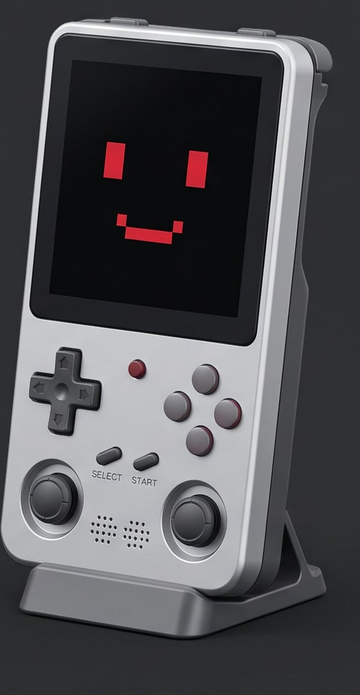
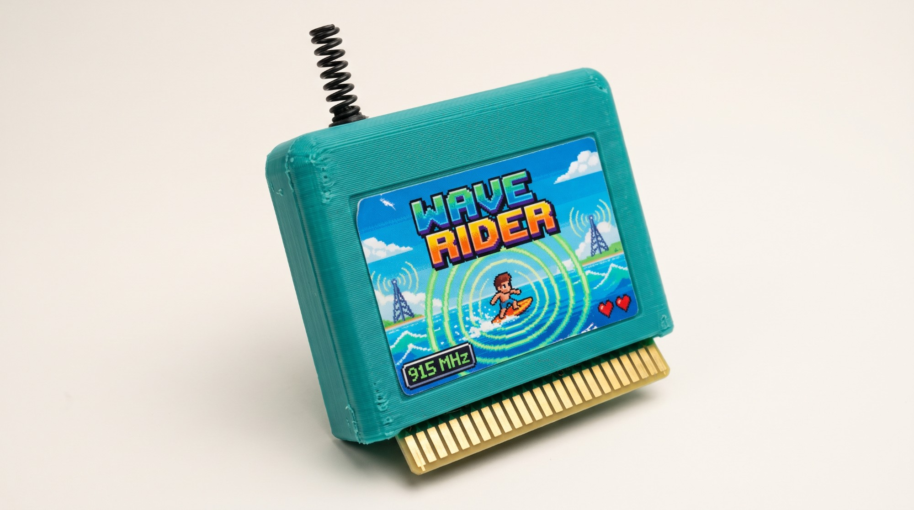
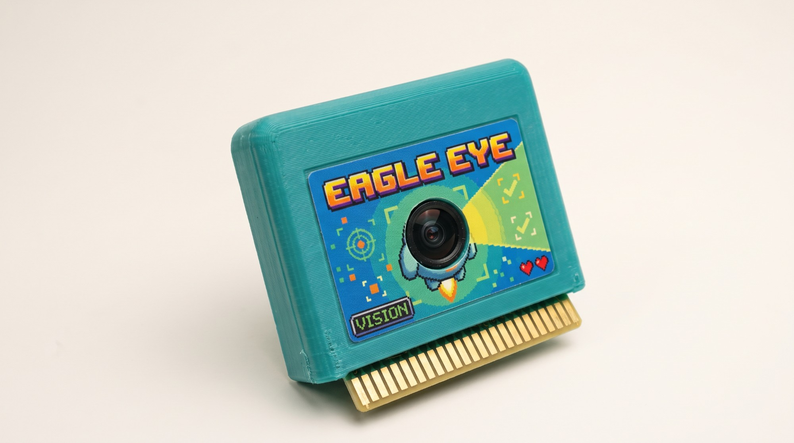

# dark-BMO — hardware do d-BMO

<p align="center">
  
  <br>
  <sub>Referência conceitual do personagem (gerada por IA, não é arte final). O corpo do hardware será desenhado a partir dela.</sub>
</p>

> Multitool portátil DIY de estudo de segurança da informação, estilo Flipper Zero, caseiro.
> Plataforma: ESP32-S3 N16R8, com corpo de videogame portátil retrô. Jogos retrô + RF / NFC / IR.


---

## Sobre

O **dark-BMO** é o hardware do **d-BMO** (BE MORE DARK), um aparelho de mão feito do zero para estudar segurança da
informação na prática: rádio sub-GHz, NFC, infravermelho, WiFi e Bluetooth. Nasceu do
reaproveitamento de um mini teclado Rii i8 achado em casa e foi crescendo até virar um
projeto completo de hardware + firmware.

O visual segue a identidade do d-BMO, definida em
[`resende-g/BMO`](https://github.com/resende-g/BMO/blob/main/docs/brand/CHARACTER_SPECIFICATION.md):
videogame portátil de emulação vertical, corpo prata, rosto em pixels vermelhos na tela,
dois analógicos e nenhum membro (ver [Aviso legal](#aviso-legal)).

É um projeto de aprendizado. O objetivo é tanto a ferramenta quanto o processo de montar,
soldar, entender barramentos e escrever firmware.

> ⚠️ **Uso responsável.** As funções de RF, NFC e IR servem para estudar protocolos e
> testar no seu próprio equipamento, em laboratório ou em CTFs. Veja [Segurança e ética](#segurança-e-ética).

---

## Índice

- [Status](#status)
- [Pessoas do projeto](#pessoas-do-projeto)
- [Versões do projeto](#versões-do-projeto)
- [Recursos](#recursos)
- [Lista de componentes (BOM)](#lista-de-componentes-bom)
- [Compras em fases](#compras-em-fases)
- [Arquitetura](#arquitetura)
- [Pinagem](#pinagem-esp32-s3-n16r8)
- [Alimentação](#alimentação)
- [Configurações críticas](#configurações-críticas)
- [Firmware](#firmware)
- [Rosto do d-BMO (tela principal)](#rosto-do-d-bmo-tela-principal)
- [Carcaça 3D](#carcaça-3d)
- [Montagem passo a passo](#montagem-passo-a-passo)
- [Roadmap](#roadmap)
- [Decisões de projeto (e alternativas rejeitadas)](#decisões-de-projeto)
- [Segurança e ética](#segurança-e-ética)
- [Aviso legal](#aviso-legal)
- [Licença](#licença)

---

## Status

**Bancada:** ESP32-S3 DevKitC-1 N16R8, tela ILI9341 e 3 botões testados, com o Bruce rodando; CC1101 recebido, ainda sem teste por falta de jumpers fêmea. **Plataforma confirmada em 02/11/2026: ESP32-S3 N16R8.** A migração para ESP32-P4 + ESP32-C6, registrada antes, foi **adiada para um d-BMO v2** (ver [Decisões de projeto](#decisões-de-projeto)): o Bruce não tem suporte à P4, as funções de WiFi bruto do Bruce não passam pelo ESP-Hosted padrão, o Retro-Go não tem alvo para P4 e a placa custaria R$ 116,91 + antena. A pinagem da S3 foi restaurada e ampliada (ver [Pinagem](#pinagem-esp32-s3-n16r8)).

---

## Pessoas do projeto

| Pessoa | Papel |
|---|---|
| **Resende** (Gabriel) | Lead do projeto: arquitetura, firmware, compras, documentação |
| **Tiago Batista** | Consultor de hardware: ensina EasyEDA e orienta o projeto da PCB para fabricar na JLCPCB (carga/BMS/card edge integrados). Também faz PCB caseira no laser, mas a decisão foi fábrica |
| **Tiago Efraim** | Impressão 3D da carcaça e montagem; monta um d-BMO em par (candidato ao cartucho LoRa p/ comunicação entre os dois) |

São dois Tiagos distintos: **Batista** cuida da PCB; **Efraim** imprime e monta junto.

## Versões do projeto

O projeto foi dividido em dois, cada um com o hardware certo para o seu propósito:

### d-BMO v1 (este repositório) — ESP32-S3 N16R8
Jogos retrô + testes de RF / NFC / IR. **Sem teclado QWERTY.** Entrada de videogame
portátil: **D-pad, quatro botões de ação, select/start, gatilhos de ombro e dois
analógicos** (sticks de controle de PS3 lidos pelo ADC). É o layout do personagem e
simplifica a montagem em relação ao teclado.

### Projeto 2 (futuro) — Raspberry Pi + teclado Rii
Kali Linux de verdade para pentest sério. O teclado QWERTY do Rii i8 vai para cá, onde
digitar comando faz sentido. Fora do escopo deste repositório por enquanto.

---

## Recursos

| Recurso | Hardware | Firmware base |
|---|---|---|
| Sub-GHz 433 MHz | CC1101 + antena SMA | Bruce |
| NFC 13,56 MHz | PN532 V3 (I²C) | Bruce |
| Infravermelho (TX + RX) | conjunto transmissor + receptor 38 kHz | Bruce |
| WiFi 4 + Bluetooth/BLE 5 | ESP32-S3 (rádio no próprio chip) | Bruce |
| Jogos retrô (NES, GB, GBC, SMS, GG, PCE) | ESP32-S3 + tela + microSD | Retro-Go (criar o alvo da placa) |
| Áudio (som + mic) | MAX98357A + speaker 8 Ω/2 W + INMP441 | firmware a desenvolver/validar |
| Rosto animado do d-BMO | tela principal ILI9341 | custom |
| Scripts / testes | — | MicroPython |

---

## Lista de componentes (BOM)

> Preços e links do AliExpress variam e expiram; use os **termos de busca** abaixo. No NFC,
> IR e áudio, confira sempre o chip (não o título genérico do anúncio).

| Item | Qtd | Termo de busca | Situação / observação |
|---|---:|---|---|
| ESP32-S3 DevKitC-1 N16R8 | 1 | já disponível | **Placa principal** (16 MB flash, 8 MB PSRAM octal, WiFi + BLE no chip, antena de trilha). Já validada com tela, 3 botões e Bruce. Na PCB final, usar o módulo ESP32-S3-WROOM-1-N16R8 (conferir estoque na JLCPCB) |
| MCP23017 (expansor de I/O I²C) | 1–2 | já disponível | O usuário tem 2 (iam para o Projeto 2). Um lê os 16 botões por I²C (0x20); o segundo (0x21) é opcional, para vibração e GPIOs do cartucho |
| ~~Antena 2,4 GHz IPEX/U.FL~~ | 0 | — | **Não precisa com a S3**: a DevKitC e o WROOM-1 têm antena de trilha. Era exigência do módulo P4 (ver Decisões de projeto). Na carcaça, deixar a ponta da antena da S3 longe de metal, da bateria e do alto-falante. A antena SMA do CC1101 continua só para o CC1101 |
| TFT 3,2" ILI9341 320×240 SPI | 1 | `3.2 ILI9341 320x240 SPI no touch` | Já comprada e validada (MSP3218 touch); pinos T_* sem ligação no v1. Tela única: rosto + menu + status |
| CC1101 433 MHz + antena SMA | 1 | `CC1101 433MHz module SMA antenna` | Já chegou; falta testar na bancada (jumpers fêmea-fêmea) |
| PN532 V3 NFC | 1 | `PN532 NFC module V3` | **Comprado em 02/11/2026** (aguardando entrega): "PN532 Set", R$ 17,20. DIP switch em I²C; endereço e compatibilidade a validar |
| Conjunto IR transmissor + receptor 38 kHz | 1 | `IR transmitter receiver 38kHz kit` | **Comprado em 02/11/2026** (aguardando entrega): "1set", R$ 7,03. Conferir que o conjunto traz TX e RX |
| MAX98357A (amp I²S) | 1 | `MAX98357A I2S amplifier` | **Comprado em 02/11/2026** (aguardando entrega): variação "Small Chip Welding" (chip BGA, pinos soldados), R$ 8,36. Alimentado direto da bateria (2,5–5,5 V); pino SD no GPIO 3 |
| Alto-falante 2030, 8 Ω 2 W | 1 | `2030 8 ohm 2W speaker` | **Comprado em 02/11/2026** (aguardando entrega): R$ 7,44. Conferir dimensões e cavidade acústica |
| Mic INMP441 (I²S) | 1 | `INMP441 I2S microphone` | **Comprado em 02/11/2026** (aguardando entrega): R$ 12,14. Captação de voz |
| ~~Módulo MicroSD SPI com conversor de nível~~ | 0 | — | **Removido em 02/11/2026.** Esses módulos baratos costumam manter o MISO ativo com o CS em alto e travam o SPI compartilhado com a tela e o CC1101. **Usar o slot SD do módulo da tela**: o MSP3218 tem slot de **SD tamanho normal** no verso (confirmado em 02/11/2026), então o cartão microSD entra com o **adaptador microSD→SD**. Conferir se há chip buffer perto do slot (se houver, testar o SPI compartilhado). Na carcaça v0, o cartão fica atrás da tela, com troca rara. Na PCB final, slot microSD próprio na tampa traseira |
| Cartão microSD ADATA | 1 | já disponível | Usuário já possui; não comprar. Verificar capacidade e formatar FAT32 conforme necessidade |
| Bateria LiPo 3,7V 1S 4000 mAh (anúncio) | 1 | `4070115 3.7V 4000mAh` | Selecionada; R$ 59,48; compra não confirmada. Dimensão informada: 0,4 × 70 × 115 mm (provavelmente 4,0 × 70 × 115 mm; confirmar medida real). **Requisitos:** PCM de proteção integrado, termistor NTC (3 fios) e vendedor com datasheet. **Conferir a polaridade do JST antes de ligar**: baterias do AliExpress vêm invertidas com frequência, e a inversão queima o carregador. Se a bateria não tiver o terceiro fio, um NTC avulso serve: 10 kΩ (marcado "103"), constante B compatível com o datasheet do carregador (3435 ou 3950), colado na célula com fita kapton, sem criar ponto de pressão. O usuário já tem um sensor de temperatura: confirmar se é NTC analógico (serve) ou digital tipo DS18B20/DHT11 (não serve para o pino TS do carregador). Ver [Riscos da bateria](#riscos-da-bateria-e-recomendações) |
| Botões tácteis | — | estoque próprio | Usuário informa que já possui vários botões; não comprar. Confirmar dimensões e quantidade na montagem (D-pad, 4 ações, select/start, 2 gatilhos de ombro, energia) |
| Analógicos (sticks de PS3) | 2 | reaproveitar | **Tirar do controle genérico de PS3 que o usuário já tem** (sem compra). Cada stick tem 2 potenciômetros (X/Y) e o clique L3/R3. Ver [Analógicos e gatilhos reaproveitados](#analógicos-e-gatilhos-reaproveitados) |
| Gatilhos de ombro (L/R) | 2–4 | estoque próprio | Botões tácteis em **ângulo reto**, como nos portáteis de emulação. Conferir se há modelos de ângulo reto no estoque; se não, comprar. Tampas: as do L1/R1 do controle de PS3 ou impressas em grafite; alavancas do L2/R2 se couberem (ver [Analógicos e gatilhos reaproveitados](#analógicos-e-gatilhos-reaproveitados)) |
| Botão momentâneo de energia | 1 | `tactile momentary push button` | Usar botão, não chave deslizante. A PCB precisará de circuito de power-latch/gerenciamento de energia para ligar e desligar com pressão; definir CI/topologia e botão conforme esquema. Não comprar chave SPST |
| Resistores 4,7k / 100k / 1k | kit | `resistor kit 4.7k 100k 1k` | **Comprado em 02/11/2026** (aguardando entrega): kit de filme metálico 1%, 30 valores (10 Ω–1 MΩ), 300 peças, R$ 19,96. Pull-ups do I²C, divisor da bateria e afins |
| Capacitores 100nF (104) | ~5 | `100nF ceramic capacitor 104` | **Comprado em 02/11/2026** (aguardando entrega): pacote de 100 peças de 100 nF (104), R$ 12,24. Desacoplamento do MCP23017 e dos módulos |
| Jumpers Dupont (F-F, M-M e M-F) | kit 40 peças | `Dupont jumper wire kit 40pcs female-female male-male male-female` | **Comprado em 02/11/2026** (aguardando entrega): variação "20cm 3kinds 120pin" (40 de cada tipo), R$ 22,10. Prioridade imediata: F-F para o CC1101 |
| Protoboard MB-102 (830 pontos) | 1 | `MB-102 breadboard 830` | **Comprado em 02/11/2026** (aguardando entrega): variação "MB-102 white", R$ 13,26. A DevKitC-1 é larga e deixa só uma fileira livre de cada lado; se precisar, usar duas lado a lado |
| Malha dessoldadora (2–3 mm) e fluxo no-clean | 1 cada | loja brasileira | Para tirar os analógicos do controle de PS3 e para a montagem. Fluxo no-clean em pasta ou caneta, nunca pasta ácida |
| Adaptador microSD→SD | 1 | loja de informática | Se não veio com o cartão: o slot da tela é SD tamanho normal |
| Fio fino 30 AWG | 1 rolo | `30 AWG silicone wire` | Comprar no Brasil: no AliExpress (carrinho de 02/11), o frete era R$ 83,04 para R$ 5,01 de fio. Fiação fina e protótipos |
| Conector/soquete card edge 2,54 mm, 20/34 pinos | 2 peças | `CE 225F 2.54mm 20 34 pin card edge slot connector` | Fase 4, fora do carrinho de 02/11/2026. Antes de comprar: confirmar se o anúncio "2*20P" (R$ 14,33) são **2 peças de 20P** (correto) ou **um soquete 2×20 = 40 contatos** (~55 mm, não cabe no cartucho de 52 mm); medir a peça real antes de fechar o footprint |


**Comprado em 02/11/2026, já com a S3 (aguardando entrega):** jumpers R$ 22,10; protoboard MB-102 R$ 13,26; PN532 R$ 17,20; IR R$ 7,03; MAX98357A R$ 8,36; alto-falante R$ 7,44; INMP441 R$ 12,14; resistores R$ 19,96; capacitores 100 nF R$ 12,24. **Total R$ 119,73**, antes do cupom de R$ 16 (se valer para o carrinho inteiro) e do imposto. Saíram a placa P4, a antena IPEX, o módulo microSD SPI e o fio de 30 AWG. Malha, fluxo e adaptador microSD→SD em loja brasileira.

Histórico — **Carrinho revisado em 02/11/2026** (antes da volta para a S3; a placa P4 saiu do carrinho): placa P4+C6 R$ 116,91; PN532 V3 R$ 17,20; conjunto IR R$ 7,03; alto-falante R$ 7,44; jumpers R$ 15,79; card edge R$ 14,33 (todos Choice, frete grátis); MAX98357A R$ 5,99; INMP441 R$ 13,89; módulo microSD R$ 4,11 e fio 30 AWG 3 × R$ 1,67 (fora do Choice). Os quatro itens fora do Choice somavam **R$ 177,91 de frete para R$ 29,10 em peças**, e o resumo não mostrava imposto nem ICMS. Decisões: o módulo microSD e o fio saem do carrinho; o MAX98357A e o INMP441 voltam depois em versão Choice; a bateria e os analógicos ainda não estão no carrinho. A compra foi dividida em fases (ver [Compras em fases](#compras-em-fases)). O usuário já possui cartão microSD ADATA e botões; não comprar. Não comprar chave SPST: será usado botão momentâneo com circuito de power-latch na PCB. Resistores e capacitores avulsos só servem para bancada: na PCB, entram como SMD montados pela JLCPCB.

**Carga + BMS + boost agora são componentes SMD na própria PCB** (projetados no EasyEDA, fabricados pela JLCPCB), não módulos avulsos TP4056/MT3608. Perfboard saiu: vai direto para a PCB projetada. Ver seção Fabricação.

**Removido do v1**: teclado Rii i8 e soquetes DIP (foram para o Projeto 2); os 2× MCP23017 voltaram em 02/11/2026 para ler os botões; **OLED 1,3" secundário** (sem o teclado, uma tela só já faz rosto + menu + status).

---

## Compras em fases

Decidido em 02/11/2026: comprar aos poucos, cada fase destrava um teste. A carcaça **não é a
primeira compra**: ela é desenhada em volta das peças que definem o volume (placa, tela,
bateria, analógicos), então só é modelada depois da Fase 2.

| Fase | Comprar | Custo aproximado | O que destrava |
|---|---|---:|---|
| 1. Núcleo + periféricos (comprada em 02/11/2026) | Jumpers, protoboard, resistores, capacitores 100 nF, PN532, IR, MAX98357A, alto-falante, INMP441 | R$ 119,73 antes do cupom e do imposto | CC1101, NFC, IR e áudio na S3 com o Bruce. Sem compra: slot SD da tela com adaptador, 1 MCP23017 nos botões, rosto do d-BMO. A Fase 3 original foi antecipada para cá, com o dinheiro que sobrou sem a P4 |
| 2. Volume + energia (próxima rodada) | Bateria com PCM + NTC **e** módulo de carga com power-path (BQ24074 ou MCP73871) na mesma compra; botões tácteis de ângulo reto se faltarem no estoque; tirar os analógicos do controle de PS3 (sem compra) | ~R$ 80–100 | Peças que definem o corpo em mãos: **modelar e imprimir a carcaça v0**. Bateria sem carregador adequado não se compra: os dois vão juntos. O módulo também valida a energia na bancada (ver [Riscos da bateria](#riscos-da-bateria-e-recomendações)) |
| 3. Periféricos | — | — | Antecipada para a Fase 1 (comprada em 02/11/2026) |
| 4. Cartuchos | Soquete card edge | ~R$ 15 | Cartucho no topo; até lá, a fenda fica com tampa cega |
| 5. Definitivo | PCB própria na JLCPCB (ESP32-S3-WROOM-1-N16R8, carga/BMS/regulador SMD, MCP23017, riser do card edge) | ~R$ 100 por 5 placas + montagem, frete e imposto | Carcaça v1 em volta da PCB definitiva |

Preços do carrinho de 02/11/2026; mudam e expiram.

---

## Arquitetura

**Plataforma: ESP32-S3 N16R8** (confirmada em 02/11/2026). O diagrama abaixo é conceitual; os pinos estão em [Pinagem](#pinagem-esp32-s3-n16r8).

```
                        ┌───────────────────┐
                        │   ESP32-S3 N16R8   │
                        │ (WiFi + BLE no chip)│
                        └─────────┬─────────┘
           ┌──────────────┬───────┼────────┬──────────────┐
          SPI            I²C      I2S      GPIO          USB
      ┌────┴────┐     ┌───┴───┐  ┌─┴──┐  ┌──┴───┐      (grava/
   Display     CC1101 PN532       MAX  INMP  botões      BadUSB)
   ILI9341     MicroSD 0x24       98357 441  + D-pad
   (3,2")                          A(5V)(mic)  IR TX/RX
```

- **SPI** (SCK/MOSI/MISO compartilhados, cada um com seu CS): Display, CC1101, MicroSD.
- **I²C** (SDA/SCL): PN532 (0x24), MCP23017 dos botões (0x20), EEPROM do cartucho. (Tela única; sem OLED secundário.)
- **I²S**: MAX98357A (saída) + INMP441 (entrada), mesmo barramento.
- **GPIO direto**: IR RX/TX, botão de energia, CS do cartucho, power-latch. Os 16 botões ficam no MCP23017, lidos por polling.
- **ADC**: 2 analógicos (4 eixos) e leitura de bateria, **só no ADC1 (GPIO 1–10)**: o ADC2 não funciona com o WiFi ligado.

---

## Pinagem (ESP32-S3 N16R8)

Tabela restaurada (tinha sido removida na migração para a P4) e ampliada em 02/11/2026 para os
analógicos, o MCP23017 e o cartucho. A tela, os 3 botões e o CC1101 já estão fixados no Bruce
(`firmware/bruce/bmo.ini`); o resto é **proposta**, a validar na bancada. Conferir contra a
serigrafia da placa.

| Função | GPIO | Nota |
|---|---:|---|
| VBAT sense | 1 | ADC1; divisor 100k/100k, ×2 no firmware |
| Analógico esquerdo X / Y | 2 / 4 | ADC1. Hoje o 2 é o botão OK e o 4 é o IR RX no `bmo.ini`: mudam quando os botões forem para o MCP23017 |
| Analógico direito X / Y | 5 / 6 | ADC1. Hoje o 5 é o IR TX no `bmo.ini` |
| I²S SD IN (mic) | 7 | mic em 3,3 V, L/R no GND |
| I²C SDA / SCL | 8 / 9 | pull-up 4,7k; PN532 0x24, MCP23017 0x20, EEPROM do cartucho |
| CS Display | 10 | |
| SPI MOSI / SCK / MISO | 11 / 12 / 13 | compartilhado: tela, CC1101, microSD, cartucho |
| CS CC1101 | 14 | |
| CC1101 GDO0 | 15 | interrupção RF |
| Display BLK | 16 | backlight (3,3 V fixo ou PWM) |
| Display DC / RES | 17 / 18 | |
| USB D− / D+ | 19 / 20 | USB nativo (gravação, serial CDC, BadUSB) |
| CS microSD | 21 | slot do módulo da tela |
| Botão de energia | 0 | strapping; GPIO RTC, acorda do deep sleep |
| Shutdown do MAX98357A (SD) | 3 | strapping (JTAG); seguro como saída depois do boot |
| CS do cartucho | 38 | na DevKitC, 38 ou 48 é o LED RGB, conforme a revisão: na bancada, usar o que não for LED |
| IR RX | 39 | |
| I²S BCLK / LRC / DOUT | 40 / 41 / 42 | DOUT para o MAX98357A |
| UART do cartucho TX / RX | 43 / 44 | UART0; liberado porque o console usa o USB CDC |
| Power-latch (HOLD) | 48 | segura a alimentação ligada depois do clique no botão |
| IR TX | 47 | |
| Livre | 45, 46 | strapping: o 45 define a tensão da flash no boot, **não usar** como saída que possa estar em alto no boot |

**MCP23017 (0x20):** 16 botões (D-pad 4, ação 4, select/start 2, L1/R1/L2/R2 4, cliques dos
analógicos 2), botão ao GND com pull-up interno do MCP. **Segundo MCP23017 (0x21), opcional:**
vibração (liga/desliga via transistor) e os 2 GPIOs do cartucho.

**Não usar:** GPIO 26–37 (flash/PSRAM octal). Cuidado com strapping: 0, 3, 45, 46.

---

## Alimentação

Todo o caminho de energia (carga da LiPo por USB-C, proteção/BMS de 1 célula e boost 5V)
fica **desenhado na própria PCB** com componentes SMD, em vez de módulos avulsos. Fluxo lógico:

```
USB-C → circuito de carga (SMD) → LiPo 1S → BMS/proteção (SMD) → [power-latch comandado por botão] → boost 5V (SMD)
   → 3,3 V para a S3 e os módulos; MAX98357A direto da bateria (ver item 6 dos riscos)
```

- Carga, proteção, boost e circuito de power-latch/gerenciamento do botão são **componentes SMD na placa** (definir topologia e CI no esquemático).
- Projeto do circuito de energia no EasyEDA, com orientação do Tiago Batista.
- Continua valendo: 5V para MAX98357A, 3,3V para o resto, nunca expor a bateria crua.
- **Limitar a corrente de carga.** Dimensionar o CI de carga para uma corrente segura (até
  ~0,5C) no EasyEDA. Essa é a parte mais crítica do projeto de energia (nota do Tiago Batista).
  Atualização de 02/11/2026: a nota original ("1 A estraga") valia para uma bateria pequena.
  Com a de 4000 mAh, 1 A é 0,25C, uma carga suave. O limite passa a ser a entrada: só com os
  resistores de 5,1 kΩ no CC, a porta garante ~500 mA (~8 h de carga). O carregador precisa
  limitar a corrente de entrada ao que a fonte oferece.
- **BMS obrigatório.** Proteção de 1 célula: não deixa cair abaixo de ~2,5–3,0 V nem passar de
  4,2 V, e monitora a carga. Entra como SMD na mesma PCB.

### Riscos da bateria e recomendações

Revisão de 02/11/2026. Uma LiPo incha principalmente por: carga acima de 4,2 V, descarga abaixo
de ~3,0 V seguida de recarga, carga em temperatura alta, ficar parada em 4,2 V por muito tempo
e pressão mecânica.

1. **Carregador com power-path e entrada NTC.** Com carregador linear simples, o aparelho
   ligado puxa corrente durante a carga, o CI não detecta o fim e a bateria fica presa em
   4,2 V por horas, o que envelhece e incha a célula. Com power-path, o sistema roda pela USB
   e a bateria só recebe a carga. Candidatos: TI BQ24074 (sem I²C) ou BQ25895/BQ25601 (com
   I²C e telemetria). Conferir estoque na JLCPCB. **Decisão em aberto.**
2. **Bateria com PCM e NTC de 3 fios.** O BMS da PCB vira a segunda camada de proteção.
3. **Polaridade do JST:** conferir com multímetro antes de ligar qualquer bateria nova.
4. **Corrente desligado ≤ ~10 µA**, somando power-latch, divisor de leitura da bateria, BMS e
   carregador. Vazamento esvazia a bateria em meses na gaveta, e recarregar depois da descarga
   profunda é causa de inchaço. O firmware desliga sozinho em ~3,3–3,4 V, antes do corte do BMS.
5. **Dois USB-C:** com as duas portas ligadas ao mesmo tempo, os VBUS se alimentam um ao outro.
   Opções: um USB-C só para dados e carga (mais simples) ou OR com diodo ideal antes do
   carregador. **Decisão em aberto.**
6. **Boost de 5 V provavelmente desnecessário.** Com a S3, nada no v1 exige 5 V: a S3, a tela, o
   CC1101 e o PN532 funcionam em 3,3 V, e o MAX98357A funciona direto da bateria (2,5–5,5 V).
   Recomendado: **buck-boost de 3,3 V** a partir da bateria, que esquenta menos que boost 5 V +
   regulador 3,3 V. Dimensionar para o pico de WiFi + CC1101 + tela + áudio, com folga. Na
   DevKitC da bancada, o pino 3V3 aceita 3,3 V direto (sem passar pelo regulador da placa).
   **Decisão em aberto:** manter ou não a linha de 5 V no conector do cartucho.
7. **Mecânica:** ~10% de folga de espessura no berço da bateria, sem cola rígida, sem aresta
   encostando, longe do regulador, do amplificador e da S3. Carcaça em PETG ou ASA, não PLA
   (amolece a ~55 °C).
8. **Validar na bancada antes da PCB:** testar o circuito de energia com um módulo pronto de
   carga com power-path, em superfície não inflamável e sem deixar carregando sozinho.

### Conector de carga USB-C dedicado

Uma **porta USB-C só para carga**, separada da porta de dados, para o usuário não confundir:

- **Só energia.** Os pinos de dados (D+/D−) ficam desligados nessa porta; ela entra no circuito
  de carga.
- **Dois resistores de 5,1 kΩ, um em cada pino CC (CC1→GND, CC2→GND), separados.** Sem eles,
  um carregador com cabo C-C entrega 0 V e o d-BMO não carrega. Ligar os dois CC num resistor só
  é erro clássico. Só com os resistores, a carga é a padrão de ~500 mA (mais corrente exige um
  CI de carga que negocie com o carregador).
- **A cor fica na carcaça, não no conector** (não há USB-C com isolador colorido à venda):
  moldura/anel colorido em volta da porta impresso em 3D, ícone ⚡ em relevo e o LED de carga
  ao lado. A porta de dados fica em outra posição/cor.

---

## Configurações críticas

- **PN532**: DIP switches em I²C (0x24). Plano B: HSU (serial) se instável.
- **ESP32-S3 N16R8** no Arduino IDE: `PSRAM: OPI PSRAM` e `Flash Size: 16MB`. Com o cabo na
  porta USB nativa, também `USB CDC On Boot: Enabled` (senão o serial fica mudo, e o UART0 fica
  livre para o cartucho).
- **Bruce**: build próprio do d-BMO em `firmware/bruce/` (`build.sh`). O PlatformIO tem que rodar
  num venv com Python 3.10 a 3.14 (o do Homebrew vem mais novo), e no ESP32-S3 a tela exige
  `USE_HSPI_PORT`, senão o Bruce trava no boot. Ao passar os botões para o MCP23017, a leitura
  em `firmware/bruce/interface.cpp` muda de GPIO para I²C.
- **Retro-Go**: criar um alvo próprio (pasta em `targets/`, com `config.h` da tela ILI9341, do
  SD e dos botões via MCP23017), a partir de um alvo ESP32-S3 existente.
- **Display**: driver ILI9341 (tela única).
- **I²C**: pull-ups 4,7k em SDA/SCL. Scan deve achar `0x24` (PN532).
- **microSD**: formatar em FAT32.

### Analógicos e gatilhos reaproveitados

Decidido em 02/11/2026: os dois analógicos saem de um controle genérico de PS3 que o usuário já tem.

- **Ao abrir o controle:** se houver bateria interna, desconectar primeiro e não perfurar. Não
  reaproveitar essa bateria no d-BMO (estado desconhecido).
- **Retirada:** cada stick tem ~10 pinos e abas de fixação grossas. Dessoldar com fluxo, solda
  nova e bomba ou malha. Alternativa mais segura: cortar a placa do controle em volta do stick
  com micro retífica e soldar fios no pedaço (fica um pouco maior).
- **Teste antes de usar:** medir a resistência entre as pontas de cada potenciômetro (costuma
  ser 10 kΩ; genérico pode ser 5 kΩ) e conferir se o pino do meio varia suave, sem saltos
  (sticks gastos têm drift).
- **Ligação:** pontas em **3,3 V e GND, nunca 5 V**; pino do meio no ADC. 4 canais de ADC (2 por
  stick, GPIO 2/4/5/6 no ADC1) + 2 cliques no MCP23017. Ver [Pinagem](#pinagem-esp32-s3-n16r8).
- **Firmware:** calibrar o centro ao ligar, guardar mínimo/máximo e aplicar zona morta. Deixar
  a calibração ajustável, porque potenciômetro barato muda com o tempo.
- **Carcaça:** medir o stick já fora do controle (área e altura com a capa); essa medida entra
  na espessura da v0.
- **Gatilhos:** no controle genérico, o gatilho costuma ser uma alavanca que aperta borracha
  condutiva sobre uma trilha da placa do controle, então a parte elétrica não serve. Se houver
  um potenciômetro no pivô do L2/R2, ele é analógico e serve como os sticks (1 canal de ADC
  cada, disputado). A parte plástica serve:
  - **L1/R1:** a tampa plástica pode apertar um botão táctil de ângulo reto já na v0.
  - **L2/R2:** a alavanca, a mola e o pino do pivô servem se a carcaça tiver o apoio do pivô
    impresso e um botão táctil embaixo. Medir antes: elas foram desenhadas para um controle
    horizontal e podem ser grandes demais para o topo do corpo vertical. Se não couberem na v0,
    usar tampas impressas e guardar as alavancas para a v1.
- **Tampas dos botões de ação e D-pad:** servem como tampa por cima de botões tácteis de
  6 × 6 mm. Imprimir um espaçador embaixo de cada uma (elas foram feitas para afundar membrana,
  não para apertar botão táctil). O furo da carcaça sai das medidas de paquímetro do corpo e
  da aba, com folga de ~0,2–0,3 mm. D-pad de peça única: imprimir o apoio do pino central e pôr
  4 botões tácteis sob as pontas; setas separadas viram tampas independentes. **Os símbolos
  △ ○ × □ coloridos vão contra a spec (botões monocromáticos) e são marca da Sony:** lixar e
  pintar de grafite, ou usar as tampas só como molde de medida e imprimir as próprias.
- **Botão redondo "P3":** pode virar o botão de energia, com o topo lixado e liso.
- **Não servem:** a placa com as membranas, as borrachas condutivas, o mini-USB e a carcaça do
  controle.
- **Extra:** os motores de vibração do controle podem servir para vibração no futuro
  (precisam de transistor para acionar). Os botões de membrana do controle não servem.

---

## Firmware

Um firmware por vez (como "cartuchos de software"):

| Firmware | Uso |
|---|---|
| **Bruce** (C++) | multitool pronto (RF, NFC, IR, WiFi/BLE). Base do projeto. Build próprio do d-BMO (versão 1.16.1, tela ILI9341 + 3 botões + CC1101) em `firmware/bruce/`: o binário oficial da DevKitC não tem tela |
| **MicroPython** | escrever Python e testar cada módulo; interativo, ótimo pra aprender |
| **Retro-Go** | jogos retrô. Roda bem NES, GB, GBC, Master System, Game Gear, PC Engine. SNES/Mega Drive lento/parcial. GBA não |
| **Modo agente** (futuro) | d-BMO como corpo remoto de um agente de IA via WiFi/BLE (WebSocket), usando speaker/mic/tela. Só firmware, sem hardware novo |

**Volume:** sem botão físico (decidido em 02/11/2026). O MAX98357A não tem controle de volume; o
volume é digital, no firmware, e o ajuste é por atalho: **segurar select + cima/baixo no D-pad**,
como nos portáteis de emulação. Guardar o nível na NVS para sobreviver ao desligamento.

No Bruce, a leitura dos 3 botões já está em `firmware/bruce/interface.cpp`. Falta o D-pad
completo e o input do emulador.

```bash
firmware/bruce/build.sh                 # compila (baixa o Bruce em ~/.cache na 1ª vez)
firmware/bruce/build.sh "" upload       # compila e grava pela USB
```

---

## Rosto do d-BMO (tela principal)

O d-BMO tem **uma tela só** (ILI9341 3,2" colorida). Ela mostra o **rosto animado do d-BMO**
quando ocioso (olhos piscam, boca reage), o **menu/terminal** quando em uso, e indicadores
de **status** (bateria / sinal / atividade). Alterna conforme o estado do aparelho.

Estilo: **blocos de pixel vermelho (#D92332) sobre fundo preto**, sem traços finos, conforme a
[spec do personagem](https://github.com/resende-g/BMO/blob/main/docs/brand/CHARACTER_SPECIFICATION.md).
Recomendação de implementação: desenhar os rostos **por código** (ex. TFT_eSPI, com
retângulos numa grade fixa), não por bitmap, para a animação ficar leve. A spec prevê dez
estados: `IDLE`, `THINKING`, `SCANNING`, `ANALYZING`, `SUCCESS`, `ALERT`, `ERROR`,
`PROTECTING`, `CURIOUS` e `OFFLINE`. Não usar rostos de personagens existentes como referência.

Primeira versão em [`firmware/rosto/`](firmware/rosto/): os 10 estados numa grade de 16 × 12 blocos (20 px), com animação
quadro a quadro e só os blocos que mudam redesenhados. Na bancada, o botão OK (GPIO 2) troca de estado e o
monitor serial aceita o número ou o nome. Os desenhos ficam em `rosto_faces.h`, em texto (`#`, `+`, `.`),
e `firmware/rosto/teste/teste_faces.cpp` confere a tabela no computador, sem placa (`--ver` imprime os
quadros). Depois de aprovado na tela, o desenho vira a tela ociosa do Bruce.

---

## Carcaça 3D

- Corpo vertical de cantos arredondados, impresso em 3D (FDM), na paleta do d-BMO: **prata**
  no corpo, **grafite/preto** na moldura da tela, nos controles e nas junções, **vermelho**
  só no rosto e em acentos pequenos. **Sem membros:** em repouso, fica num **suporte
  inclinado grafite** separado.
- **Layout:** tela no **topo** com moldura preta; abaixo, D-pad à esquerda e quatro botões de
  ação em losango à direita (grafite ou prata, nunca coloridos); select/start no centro;
  **dois analógicos** embaixo, um de cada lado; grade do speaker entre eles; gatilhos de
  ombro no topo. **Sem teclado.**
- **Uma tela só** (ILI9341) no topo, grande, para rosto + menu + status.
- **Acabamento prata sem metal de verdade** na frente e atrás: PLA/PETG prata ou pintura. Corpo
  metálico bloqueia o NFC e atenua sub-GHz/WiFi. Isso descarta a opção de usinar o corpo em
  alumínio na JLCPCB, salvo com janelas plásticas sobre as antenas.
- **Conector de expansão no topo:** o cartucho entra pela **borda superior**, paralelo ao
  corpo, como nos portáteis clássicos. Não fica na face frontal. O conector expõe I²C + 3V3 +
  GND + GPIO livre, com polyfuse/resistor em série na alimentação (protege o ESP32 de curto no
  módulo plugado).
  - Como o DK920A-20M é vertical (furo passante), ele vai numa **plaquinha riser**
    perpendicular à PCB principal, no topo, ligada por barra de pinos ou conector placa-placa.
    Alternativa: soquete card edge em ângulo reto, se existir em 2,54 mm com a mesma pinagem.
  - **Solução escolhida: card edge** (borda da PCB vira contato, estilo cartucho). Com a PCB
    indo para a JLCPCB (fábrica), a densidade deixa de ser problema e o **card edge COMPLETO**
    é viável: I²C + SPI + UART + 3V3 + 5V + GND + 2 GPIO (~13 a 15 contatos).
  - **Conector fêmea primeiro (definido):** o soquete que recebe o cartucho é escolhido antes
    do cartucho (ele dita largura, nº de contatos, pitch e espessura de placa). **Soquete
    escolhido: DK920A-20M** (card edge 2,54 mm, 2×10 = 20 contatos, furo passante/vertical,
    fenda de 1,9 mm para cartucho de 1,6 mm, contatos de ouro, 2 A/contato). Soldado na PCB
    principal. Medir a peça real antes de desenhar a pegada no EasyEDA (ver Especificação do cartucho).
  - Proteção obrigatória: polyfuse na linha de alimentação do conector e CS dedicado no SPI.
- **Traseira multifuncional (em duas zonas):**
  - Zona de cima **fixa** (parafusada, segura a eletrônica).
  - Zona de baixo é uma **tampa/porta** que abre e dá acesso a: **bateria**, **berços para
    guardar os cartuchos reserva** (estojo; o cartucho ativo pluga no card edge em cima) e o
    **slot do microSD**. O microSD fica DENTRO dessa zona, acessível só ao abrir a porta, nada
    exposto por fora (troca é rara, não vale abertura permanente juntando poeira).
  - **Fecho da tampa: 1 parafuso + lábio de encaixe no lado oposto** (sem dobradiça, sem ímã;
    dobradiça viva racha e ímã foi descartado). O lábio enfia num rebaixo e o parafuso tranca o
    outro lado.
  - **Rosca do parafuso:** reaproveitar um **standoff hexagonal de metal** (daqueles de
    placa-mãe, que Resende já tem) embutido num **furo hexagonal justo** no CAD, dando rosca
    metálica de graça. Plano B se o standoff girar na prática: **heat-set insert** M2/M3.
    Testar o encaixe hex num corpo de prova na impressão antes de fechar o design.
- Demais parafusos de fechamento da carcaça também em **heat-set/standoff na traseira** (não na frente).
- Ergonomia por chanfro/arredondamento das arestas inferiores, mantendo o corpo retangular.
- Topo: cartucho (centro), antena SMA e furo do mic, distribuídos para não colidir com os
  gatilhos de ombro. Antena do PN532 virada para fora sem metal atrás; LED + receptor IR na
  frente; grade do speaker no canto inferior; furo do mic no topo; 2× USB-C + chave numa
  lateral. (O microSD não fica na lateral: fica dentro da porta traseira, ver acima.)
- Detalhes mecânicos precisos (recorte de botões, heat-sets, bosses) saem do **CAD**
  (Fusion / Tinkercad / FreeCAD), não de gerador de imagem.

### Carcaça v0 (protótipo)

Primeira carcaça, impressa depois da [Fase 2](#compras-em-fases), antes da PCB própria:

- Leva a **DevKitC S3 inteira**, presa por suportes impressos (a DevKitC não tem furos de
  fixação), com os módulos ligados por fio. É protótipo: a decisão de não usar fiação manual
  vale para a versão final.
- Forma externa da variação 1 já na v0; espessura, parafusos e encaixe interno mudam na v1.
- Furos e fendas de todas as peças já impressos (grade do speaker, mic, janela do IR, saída
  SMA, fenda do cartucho, USB-C). Os que ainda não têm peça ficam com **tampas cegas**.
- A antena de trilha da S3 fica na ponta da DevKitC: posicionar essa ponta perto de uma borda
  da carcaça, longe da bateria, do alto-falante e de metal.
- Contar com 2 ou 3 reimpressões. Antes, um corpo de prova pequeno com o encaixe dos standoffs
  e dos parafusos.

### Fabricação: EasyEDA + JLCPCB (decidido)

Após reunião com o Tiago Batista (23/10/2026), a decisão foi **não usar perfboard nem PCB
caseira no laser**, e sim projetar a placa no **EasyEDA** e fabricar na **JLCPCB** (fábrica, China):

- **PCB única** com o ESP32-S3 e todo o circuito, incluindo **carga, BMS e boost como CIs SMD**
  soldados de fábrica (os CIs minúsculos que não dá para soldar em casa vêm prontos).
- **Mais barato do que parece:** ordem de ~R$ 100 por um lote de ~5 placas (confirmar na cotação).
- Resende só encaixa os periféricos grandes (ESP32 se não for SMD, tela, antena) quando a placa chegar.
- O **card edge** do conector de expansão sai nessa mesma PCB, com qualidade de fábrica.
- Papel do Tiago Batista: **ensinar o EasyEDA e orientar o projeto**; a fabricação é da JLCPCB.
- A JLCPCB também faz **impressão 3D / usinagem da carcaça** (plástico, alumínio, titânio) — opção
  em aberto para o corpo, concorrendo com a impressão do Tiago Efraim (ver Carcaça 3D).

Fluxo: desenhar no EasyEDA → cotar/fabricar na JLCPCB → receber → soldar periféricos → montar na carcaça.

### Cartuchos de expansão (o que o card edge permite)

O conector expõe sinais; o cartucho plugado decide a função. **Não** adiciona processamento
(o cérebro continua sendo o ESP32) nem é slot de armazenamento rápido. Com o nível completo,
os cartuchos possíveis:

- **Rádio/RF extra** (via SPI): segundo rádio em outra frequência (868, 315), LoRa, outro NFC/RFID.
- **GPS** (via UART/I²C): georreferenciar capturas.
- **Sensores e módulos** (via I²C): ambientais, telas pequenas, leitores, e os módulos prontos
  da M5Stack/Seeed.
- **Cartuchos temáticos**: cada cartucho como uma "ferramenta" ou "jogo" físico, no espírito dos
  cartuchos de videogame.

**Referências visuais (família de cartuchos):** carcaça grafite com detalhes prata e a mesma
borda de contatos dourados. As imagens abaixo ainda são do visual antigo (teal) e serão
geradas de novo; cada cartucho é uma "capa de jogo" em pixel art, com um nome que funciona como
título de jogo antigo e codifica a função (sem logo de marca). Prompts em
[docs/cartuchos-prompts.md](docs/cartuchos-prompts.md).

| WAVE RIDER — cartucho LoRa 915 MHz (antena de mola) | EAGLE EYE — cartucho câmera (lente frontal, visão p/ o modo agente) |
|---|---|
|  |  |

Servem de referência do card edge para o projeto no EasyEDA e para o CAD. Com o soquete
DK920A-20M (2×10), os **contatos ficam nos dois lados** da língua (10 na frente, 10 atrás),
como numa placa de memória. O cartucho câmera (EAGLE EYE) tem a lente na face frontal: o módulo (ex. OV2640) fica
virado para fora, no lado oposto aos contatos, e a carcaça do cartucho precisa de um furo para
a lente.

Nota técnica do LoRa: a etiqueta da imagem diz 433 MHz, mas no Brasil o LoRa opera na faixa ISM
de **915 MHz** (Anatel: 902-907,5 e 915-928). 433 MHz é a faixa do CC1101 comum. Ajustar para
915 se/quando o cartucho LoRa for feito de verdade. "LoRa" é marca da Semtech (uso conceitual
apenas, não comercial).

Limite honesto: o card edge não torna o d-BMO mais rápido nem roda IA local; para um "cérebro
extra" o cartucho precisaria do próprio processador (outro projeto). O uso mais valioso para o
propósito de segurança é o **cartucho de rádio/sensor extra**.

### Anatomia de um cartucho (importante)

O **card edge não vem pronto** em nenhum módulo. Um cartucho é montado de duas partes:

1. **Módulo da função** (comprado, ex. módulo LoRa SX1276/1278 do AliExpress): traz o chip e
   tem pinos normais (SPI, energia). Faz o trabalho (rádio, GPS, sensor), mas NÃO tem a borda
   de contatos.
2. **PCB-cartucho** (projetada no EasyEDA, fabricada na JLCPCB): é a placa com o formato de
   cartucho e os **contatos card edge na borda**. O módulo da função é soldado em cima dela, e
   as trilhas ligam os pinos do módulo aos contatos certos da borda.

```
[Módulo LoRa comprado] --soldado em--> [PCB-cartucho c/ card edge] --encaixa no--> [conector do d-BMO]
```

Ou seja: **cartucho completo = módulo da função + PCB-cartucho com card edge**. O conector
fêmea (a fenda que recebe o cartucho) fica no corpo do d-BMO. O AliExpress dá o cérebro do rádio;
a PCB-cartucho (desenhada no EasyEDA, fabricada na JLCPCB) dá o corpo do cartucho.

### Especificação do cartucho (card edge)

Casada com o soquete **DK920A-20M** e com as regras de contatos dourados da JLCPCB.

- **Placa:** 1,6 mm de espessura, 2 camadas. Tamanho total **52 × 52 mm** (não 50): a JLCPCB
  **não faz o chanfro dos contatos em placa menor que 50 × 50 mm**, então 52 dá folga. Mesma
  medida para todos os cartuchos (modelo único).
- **Língua de encaixe:** a abertura do soquete tem ~28,3 mm, então a parte que entra é uma
  **língua de ~27,8 mm de largura** (com folga), com degraus que se alargam até o corpo de
  52 mm — formato de placa de memória/PCI. Comprimento da língua = profundidade da fenda do
  soquete (a medir na peça, ~8 mm). Os degraus servem de batente.
- **Contatos:** 2×10 = 20, pitch 2,54 mm (10 na frente, 10 atrás), centralizados na língua
  (22,86 mm da 1ª à última), a **0,6 mm da borda**, com **máscara de solda aberta** sobre eles.
- **Acabamento JLCPCB:** contatos dourados exigem **ENIG**; **chanfro de 30°** na ponta da
  língua. Cantos da ponta cortados a 45° no contorno ajudam a centralizar.
- **Durabilidade:** o ouro do ENIG é fino e desgasta com muitas trocas (a JLCPCB recomenda ouro
  duro para encaixe frequente, não confirmado como opção no pedido). Para troca ocasional de
  cartucho, ENIG + guias na fenda deve bastar.
- **Anti-inversão:** o soquete é simétrico. Deslocar a língua um pouco para um lado e fazer a
  fenda da carcaça com o mesmo deslocamento, para o cartucho invertido (que trocaria 5 V por
  3,3 V nos pinos) não entrar.
- **Apoio mecânico:** o DK920A não tem abas de fixação; toda a força de encaixe cai nas 20
  soldas. A carcaça precisa de um apoio encostado no corpo do soquete.
- **Pegada na PCB principal:** 2×10 furos (~1,0 mm), pitch 2,54 mm, 5,08 mm entre as fileiras;
  contorno do corpo 31,7 × 9,2 mm; altura ~10,2 mm acima da placa (na riser, define a folga até
  o topo da carcaça). Partir da pegada "20 PIN CARD EDGE CONNECTOR - 2.54MM (MALE)" da biblioteca EasyEDA.
- **Reconhecimento (opcional):** uma EEPROM I²C pequena (ex. 24C02) em cada cartucho guarda o
  "nome" dele, e o d-BMO identifica sozinho o que foi plugado — usa o I²C que já está no conector.
- **A confirmar na JLCPCB:** se ela chanfra uma língua com degraus (padrão de placa de memória,
  deve dar) e se o mínimo de 50 mm vale para os dois lados ou só largura (se for só largura, o
  cartucho pode ficar mais curto, ~52 × 25 mm, e sair menos para fora da frente).

> Ponto em aberto (pede decisão): com cartucho de 52 × 52 mm o soquete prende só ~8–10 mm e
> **~40 mm do cartucho ficam para fora do topo**, competindo com a antena SMA, o furo do mic e
> os gatilhos de ombro. Alternativa: cartucho curto
> (52 × 25 mm) num painel destacável de 52 × 52 para ganhar o chanfro de fábrica — depende da
> resposta da JLCPCB acima.

### Dimensões conhecidas
| Peça | Medida |
|---|---|
| Tela principal (placa) | 89,3 × 55,04 mm (datasheet; na régua deu 88 × 54); vidro visível ~70 × 51 mm (régua); área ativa 64,8 × 48,6 mm (datasheet) |
| Bateria selecionada | dimensões anunciadas 0,4 × 70 × 115 mm; confirmar unidade e medida real |
| ESP32-S3 DevKitC-1 N16R8 | medir com paquímetro (comprimento, largura e altura com os pinos) |
| Cartucho (PCB) | 52 × 52 mm, 1,6 mm; língua ~27,8 mm |
| Soquete DK920A-20M (corpo) | 31,7 × 9,2 mm, altura ~10,2 mm; fileiras a 5,08 mm; fenda 1,9 mm |

> A medir: altura livre acima dos controles, que define a orientação da tela principal.
> A medir na tela, com paquímetro antes do CAD: espessura total com o painel de toque e o
> contorno do vidro.
> A medir na peça do soquete: profundidade da fenda (define o comprimento da língua) e se
> aceita placa de 1,6 mm (encaixar uma sobra de PCB e ver se entra justa).

---

## Montagem passo a passo

1. Entrada do v1 definida: D-pad + botões + dois analógicos (sticks de PS3 no ADC).
2. **Validação antes da PCB.** A simulação do EasyEDA não valida firmware nem periféricos como um protótipo real. Validar na S3 a tela, o CC1101, o PN532, o microSD, o MCP23017, os analógicos e o áudio antes de congelar a pinagem.
   - **Bancada:** a S3 já roda o Bruce com a tela e 3 botões; falta o CC1101 (jumpers F-F) e o resto, um módulo por vez.
   - Teste do CC1101: ler o registrador de versão por SPI e testar captura/reenvio apenas em equipamento próprio/autorizado.
   - Usar os sketches existentes (`firmware/teste_tela`, `firmware/teste_cc1101`) como referência.
3. Projetar a PCB no EasyEDA: ESP32-S3-WROOM-1-N16R8 + MCP23017 + periféricos + **carga/BMS/boost SMD** + **card edge** do conector.
   Cotar e fabricar na JLCPCB.
4. Com a placa pronta, soldar/encaixar os periféricos (tela, antena, botões, módulos).
5. Firmware: Bruce (base), rosto do d-BMO na tela, retrogames no cartão SD.
6. Ligar botões/D-pad e integrar no input do firmware.
7. Carcaça (impressão do Tiago Efraim ou JLCPCB) + bateria comprada pela medida.

---

## Roadmap

- [x] Fechar entrada: D-pad + botões + dois analógicos (sticks de PS3 no ADC)
- [ ] Projetar a riser do card edge no topo
- [x] Bancada anterior: ESP32-S3 DevKitC confirmada (16 MB + 8 MB PSRAM), tela ILI9341 validada (ID 0x9341) e Bruce rodando com 3 botões
- [x] Fase 1 + periféricos comprada no AliExpress em 02/11/2026 (R$ 119,73 antes do cupom e do imposto)
- [ ] Comprar malha, fluxo e adaptador microSD→SD no Brasil
- [ ] Próxima rodada: bateria com PCM + NTC e módulo de carga com power-path, juntos
- [ ] Ligar o slot SD da tela (cartão microSD com adaptador SD) no CS 21
- [ ] Ligar 1 MCP23017 e passar os botões para ele (Bruce `interface.cpp`)
- [ ] Validar a pinagem proposta da S3 e atualizar o `bmo.ini`
- [ ] Fase 2: tirar e testar os analógicos do controle de PS3; comprar a bateria (PCM + NTC); modelar e imprimir a carcaça v0
- [ ] Decidir carregador (power-path), USB-C único vs OR com diodo ideal, e se o cartucho mantém a linha de 5 V
- [ ] Validar o circuito de energia na bancada antes de fechar a PCB
- [ ] Criar o alvo do Retro-Go para a placa (ILI9341 + SD + MCP23017)
- [ ] CC1101 na bancada (`teste_cc1101` e captura de 433 MHz no Bruce): faltam jumpers fêmea
- [ ] NFC (PN532) lendo tag
- [ ] IR TX/RX
- [ ] Áudio (speaker) + mic
- [ ] Rosto animado na tela principal: sketch em `firmware/rosto/` compilado; falta testar na bancada e levar para o Bruce
- [ ] Retro-Go rodando um jogo
- [ ] Comprar o soquete DK920A-20M e medir a peça real (fenda, espessura aceita)
- [ ] Projetar a PCB no EasyEDA (com carga/BMS/boost/card edge) e cotar na JLCPCB
- [ ] Fechar a especificação do cartucho (língua, anti-inversão) e o modelo único no EasyEDA
- [ ] Definir carcaça: impressão do Tiago Efraim vs JLCPCB
- [ ] Modelar carcaça no CAD
- [ ] Imprimir e montar
- [ ] (Futuro) Modo agente via WiFi/BLE
- [ ] (Futuro) Projeto 2: Raspberry Pi + Rii + Kali

---

## Decisões de projeto

Alternativas avaliadas e **descartadas** (documentadas para não repetir):

| Alternativa | Por que não |
|---|---|
| Raspberry Pi / Kali no lugar do ESP32 | Categoria errada (computador vs microcontrolador). Vira o Projeto 2 separado |
| M5Stick / Cardputer ADV | Sem sub-GHz, NFC nem IR-RX de fábrica |
| Placas ESP32 + tela integradas (Guition, JC3248) | Consomem quase todo o GPIO; algumas com 4MB flash matam o gaming |
| Displays e-ink | Refresh lento demais para UI interativa e jogos |
| Segundo ESP32 / placa de processamento acoplada | O "cérebro extra" é remoto por WiFi/BLE, não acoplado por fio |
| Teclado QWERTY no v1 | Removido de propósito; vai para o Projeto 2 (Pi/Kali) |
| Pendrive USB como armazenamento | O microSD já cobre |
| Botões físicos de volume ou roda de volume | Volume por atalho (select + cima/baixo); evita ocupar o 2º MCP23017 e o ADC1, que não tem canal livre, e um potenciômetro na saída do amplificador desperdiçaria energia |
| Módulo microSD SPI com conversor de nível | Trava o SPI compartilhado; usar o slot SD da tela ou um slot na PCB |
| ESP32-P4 + ESP32-C6 (Guition JC-ESP32P4-M3-DEV) no v1 | **Adiada para o v2 (02/11/2026).** O Bruce não suporta a P4; o ESP-Hosted padrão não expõe modo promíscuo nem TX 802.11 bruto, base das funções de WiFi do Bruce; o Retro-Go não tem alvo para P4; custaria R$ 116,91 + antena IPEX; a S3 já roda o Bruce. Reavaliar quando houver suporte oficial, ou se o foco virar SNES/Mega Drive, câmera MIPI ou USB HS |
| Comprar todas as peças de uma vez | Dividido em fases por orçamento; a carcaça v0 só depois das peças que definem o volume |
| Segunda tela (OLED de status) | Sem o teclado, a tela única ILI9341 faz rosto + menu + status |
| Perfboard / fiação manual | Substituído por PCB projetada (EasyEDA → JLCPCB); montagem mais limpa |
| PCB caseira no laser | Fábrica (JLCPCB) faz trilha mais fina e já solda os SMD de carga/BMS |
| Módulos avulsos TP4056 + MT3608 | Carga/BMS/boost integrados como SMD na PCB |

---

## Segurança e ética

Este é um projeto educacional de segurança da informação. As capacidades de RF (sub-GHz),
NFC e IR existem para **aprender como os protocolos funcionam** e para testar em equipamento
próprio, em laboratório ou em competições de captura de bandeira (CTF).

Não use para interferir, acessar ou clonar sistemas, cartões, controles ou dispositivos de
terceiros sem autorização explícita. Rádio, NFC e IR são regulados; respeite a legislação
local (no Brasil, Anatel e leis de crimes cibernéticos, entre outras). A responsabilidade
pelo uso é de quem monta e opera.

---

## Aviso legal

O d-BMO é um personagem original: videogame portátil de emulação, prata, sem membros, com
rosto em pixels vermelhos. A especificação, os elementos de distinção e os vedados estão em
[`CHARACTER_SPECIFICATION.md`](https://github.com/resende-g/BMO/blob/main/docs/brand/CHARACTER_SPECIFICATION.md).

Até 2026-11-02, este repositório usava um visual inspirado no personagem BMO de *Adventure
Time* (Cartoon Network / Warner Bros. Discovery). Esse visual foi abandonado, e as imagens
antigas foram removidas da árvore atual. Este projeto não é afiliado, patrocinado nem
endossado por esses detentores de direitos.

---

## Licença

Código sob [MIT](LICENSE). Documentação sob
[CC BY-NC 4.0](https://creativecommons.org/licenses/by-nc/4.0/) (não comercial, pelo aviso acima).

---

*Projeto pessoal de aprendizado. Feito com ESP32, solda, impressão 3D, ajuda dos amigos e
muita pesquisa. BE MORE DARK.*
